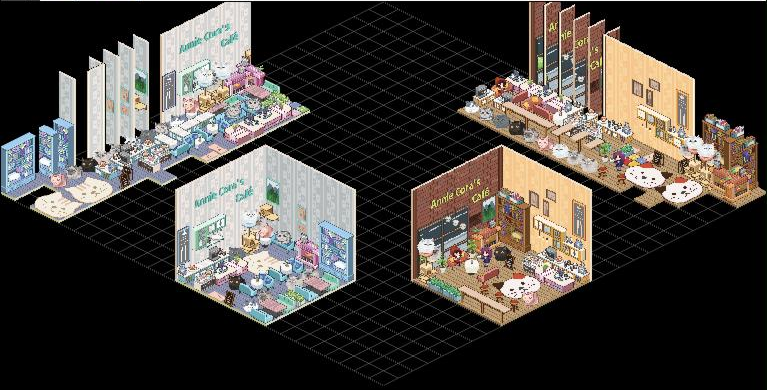
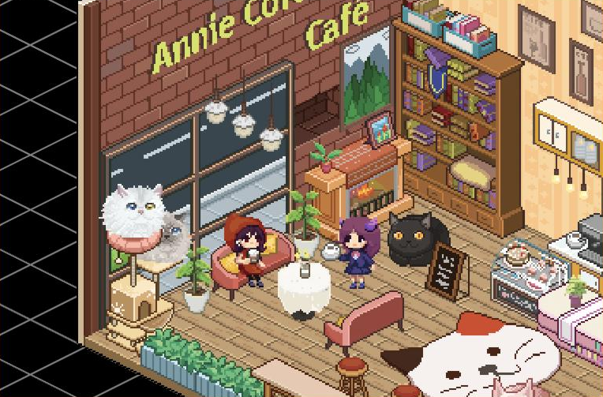
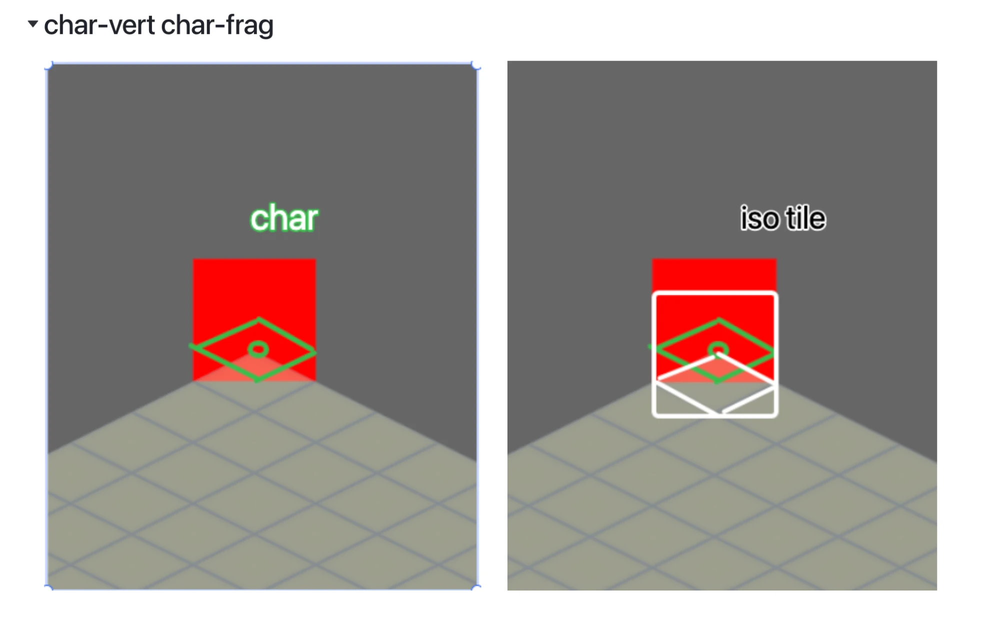
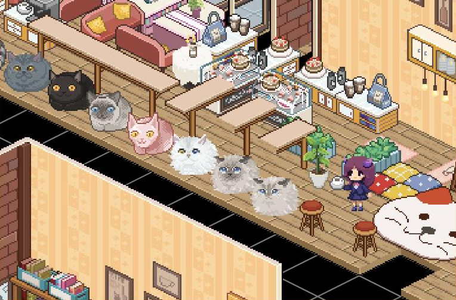
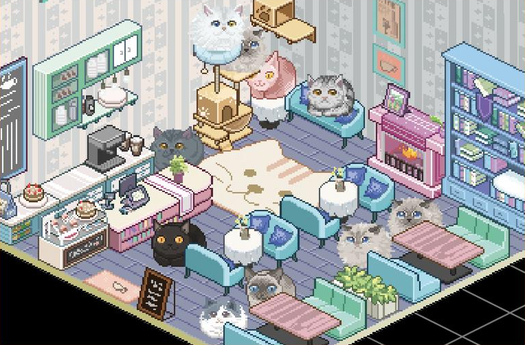

Annie and Cora's Café is our cat café game. Its world is an isometric grid: floor tiles, walls, furniture, cats and people, all standing on diamonds. Every one of them is a flat sprite, a rectangle cut out of a sprite sheet. Turning those rectangles into a room that looks right is almost entirely the job of one vertex shader, `iso-vert.glsl`. This post walks through what it does.

**[Play the café demo on itch.io ↗](https://abobobox.itch.io/cat-cafe)** It opens our level editor with four furnished rooms. Drag to look around, and use the magnifier to zoom in on the cats.

*The screenshots in this post come from that demo, our 2024 web build, which still draws with Canvas 2D. The shaders below are the WebGL2 version of the same placement.*


*The whole map in the editor. Every room, wall and cat stands on the same diamond grid.*

## From a grid cell to the screen

In an isometric view the grid is turned 45° and squashed to half its height, so every cell becomes a diamond twice as wide as it is tall. Moving one cell along the grid's x axis goes right and down on screen. Moving one cell along its y axis goes left and down. That is a 2D linear map, so it fits in one matrix:

```glsl
#define ISO_MAT(s) mat3(vec3( float(s)*0.5, -float(s)*0.25, 0), \
                        vec3(-float(s)*0.5, -float(s)*0.25, 0), \
                        vec3(0, 0, 1))
```

`s` is the width of one tile on screen. A grid point `(col, row)` lands at `x = s/2 · (col − row)` and `y = −s/4 · (col + row)`, which is the top corner of that cell's diamond. The third column passes depth straight through, which matters later.

The same shader also draws top-down and platformer scenes. `GET_CANVAS_MAT` picks this matrix in isometric mode and a plain scale otherwise, so the rest of the code doesn't care which view it's in.

## Hanging a sprite on its cell

The matrix only places a point. The sprite is a quad, so each corner adds its `uv` times the sprite's size, and then the whole quad is shifted by a pivot:

```glsl
vec3 origin = GET_CANVAS_MAT(mode, gridUnitSize)*position;
texSize *= gridUnitSize;
vec2 quadPos = uv*texSize;

vec2 alignPivot = vec2(mulX * texSize.x, mulY * texSize.x);
return vec3(origin + vec3(quadPos + alignPivot + offset, 0));
```

For a tile, both multipliers are −0.5. Shifting left by half the width centers the quad on the cell. Shifting down by half the width puts the bottom of the quad on the cell's bottom corner, because a diamond is half as tall as it is wide. A taller sprite, like a wall or a shelf, simply grows upward from there.

Notice that the vertical pivot uses the sprite's width, not its height. A table that covers 2 × 2 cells is twice as wide, its diamond is twice as tall, and its bottom corner is twice as far down. Using the width keeps that true for any footprint.


*Tall sprites like the bookshelf and the window wall grow upward from their cell, while floor tiles, rugs and stools keep to theirs.*

## Why a character sits a quarter tile higher

Characters use the same function with one difference: their vertical multiplier is −0.25 instead of −0.5.


*A test character, alone and over an iso tile at the same grid index. The tile is pushed down by half its width, the character by only a quarter.*

The reason is where each one is placed. Tiles sit on whole cells, so their position is the cell's index, the top corner of the diamond. Characters walk around freely, and we place them by their center: a character in cell `(col, row)` is at `(col + 0.5, row + 0.5)`. Half a cell along both grid axes is a quarter of a tile further down on screen. So the character's quad already starts a quarter tile lower, and only needs the other quarter from its pivot. Both quads end on the same bottom corner, and the character's feet, drawn a quarter tile above the bottom of its sprite, land in the middle of the tile.

Particles skip the pivot completely. They are positioned by their own center, so `MODE_PARTI` sets both multipliers to zero.

## Drawing back to front

In an isometric scene, things further back must be drawn first, or a cat behind a table ends up on top of it. Before drawing, the engine sorts each layer by `0.5 * (col + row)`, the sprite's distance down the screen. Furniture that covers more than one cell gets an extra pass of swaps, since a big sprite can be in front of one neighbor and behind another.


*Cats, tables and stools overlap all along this counter. Each one has to be drawn after everything behind it.*

Then the order is turned into depth. Each sprite in the sorted list gets a depth a little closer than the one before:

```js
let depth = this.depthStart; //cam far-near     -100 --- 0
this.deltaDepth = this.depthSpan / (sortedLayerContent.length + 1);

for (let {type, boundary, sourceID, index, clipID, mode = 0,} of sortedLayerContent) {
    depth += this.deltaDepth;
    // ...
```

Depth goes into the matrix as the third coordinate and comes out unchanged. So the GPU's depth test keeps the order, even when sprites from different sprite sheets end up in different draw calls.

## One vertex, 13 floats

Every sprite is two triangles, six vertices, and every vertex carries everything the shaders need: 13 floats, 52 bytes.

* `mode`: flip bits, so one drawing can face left or right
* `gridIndex`: the cell
* `uv`: which corner of the quad this is
* `texBoundary`: the sprite's cell rectangle in its sheet
* `texSrcIndex`: which sheet in this batch
* `depth`: the draw order from above
* `aniFrames` and `aniFPS`: the animation

Flipping is done on the `uv` before placing the quad, so a mirrored chair needs no extra art. Animation works like in our [blast post](/work/webgl-blast-texture-atlas/): frames sit side by side in the sheet, and the fragment shader slides the rectangle along by the frame number:

```glsl
float frameIndex = floor(mod(uTime*vAniFPS,vAniFrames));
// ...
boundaryIndex.x += texBoundarySize.x * frameIndex;
```

When the player selects tiles, they are marked in a small texture the size of the grid. The vertex shader looks its cell up there, and if it's set, bounces the sprite with `abs(sin(uTime*jumpSpeed)) * jumpHeight`.

## Many sheets in one draw

A café uses many sprite sheets: floors, walls, furniture, each cat. Instead of one draw call per sheet, the engine packs several sheets into one batch with a best-fit-decreasing pass, up to eight per batch. Each vertex says which slot its sheet is in, and the fragment shader keeps a small array per slot: the sheet's cell size, its full size, and which textures hold it.


*One room pulls from many sheets: walls, sofas, tables, shelves and a different sprite for every cat.*

## Sheets bigger than the GPU allows

The game also runs as a WeChat Mini Game, and on Android that platform limits how big one texture can be (8K). Our sheets can be bigger, so they are cut into slices, and the shader puts them back together. It first works out the pixel in the whole sheet, then finds the slice that contains it:

```glsl
vec4 rdTexSlice(vec2 uv, vec2 texRes, int sliceStartIndex,int sliceEndIndex, vec4 slicedTexRange[MAX_TEXTURE_COUNT],sampler2D textures[MAX_TEXTURE_COUNT]){
    vec2 pixel = uv*texRes;
    for(int sliceIndex=sliceStartIndex;sliceIndex<sliceEndIndex;sliceIndex++){
        vec4 rectRange = slicedTexRange[sliceIndex];
        if(all(greaterThanEqual(pixel,rectRange.xy)) && all(lessThan(pixel,rectRange.zw)))
        return sampleSlice(sliceIndex,(pixel-rectRange.xy)/(rectRange.zw-rectRange.xy), textures);
    }
    return vec4(0);
}
```

The test is half-open, `>=` at the start and `<` at the end, so a pixel right on a seam belongs to exactly one slice. Sampling the slice took two more workarounds. GLSL ES 3.00 only lets you index an array of samplers with a constant, so `sampleSlice` is a chain of `if (index == 0) …` lines, one per texture unit. And inside that kind of branch the GPU can't work out which mipmap level to use, so every lookup is a `textureLod` at level 0.

One last detail: every lookup is pulled in by two texels from the cell's edge (`TEXEL_SHINK`). Without that, a lookup right at the border of a cell can pick up pixels of the neighboring sprite in the sheet.

## What we took away

* An isometric view is one matrix. Everything else is choosing the right pivot.
* Use the sprite's width for the vertical pivot, and multi-cell furniture lines up for free.
* Things placed by their corner and things placed by their center need different pivots. A quarter tile is exactly the difference.
* Sort back to front once, then hand the order to the depth buffer, and batches can be drawn in any order.
* Platform limits shape the shader: texture size, constant sampler indices and mipmaps in branches all left their mark on `texture-slice.glsl`.
