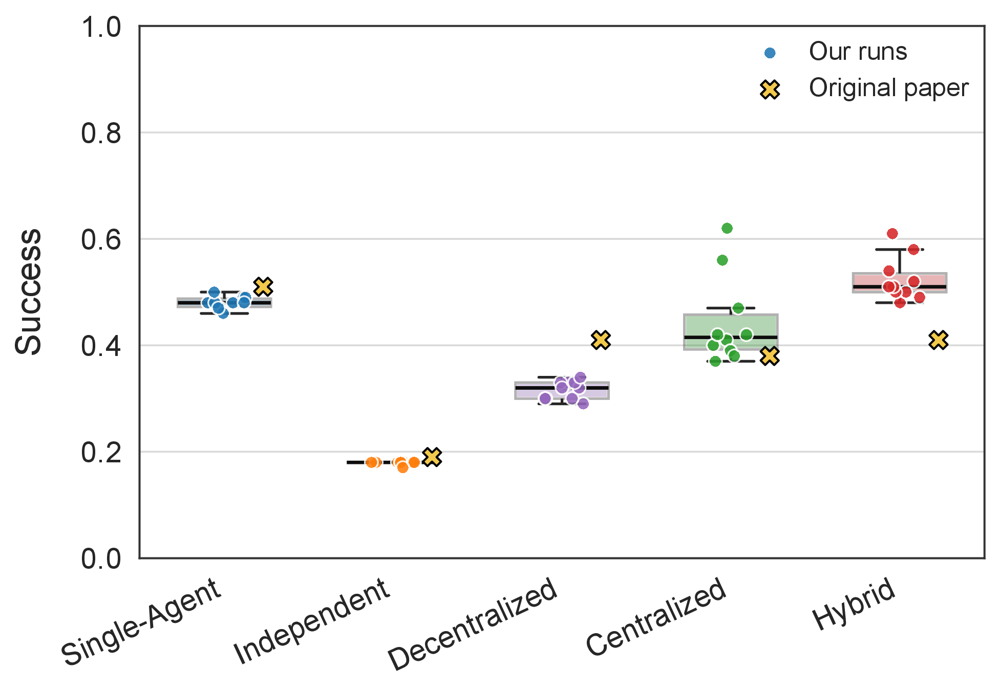
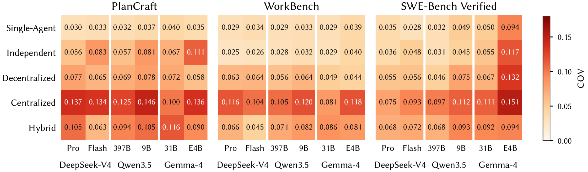
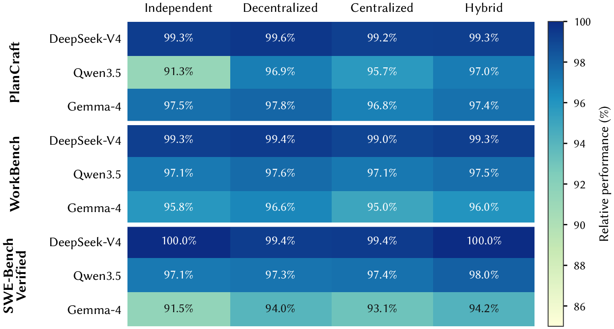
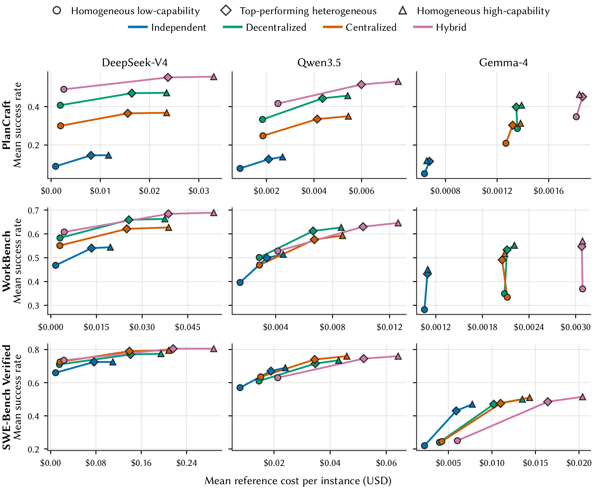
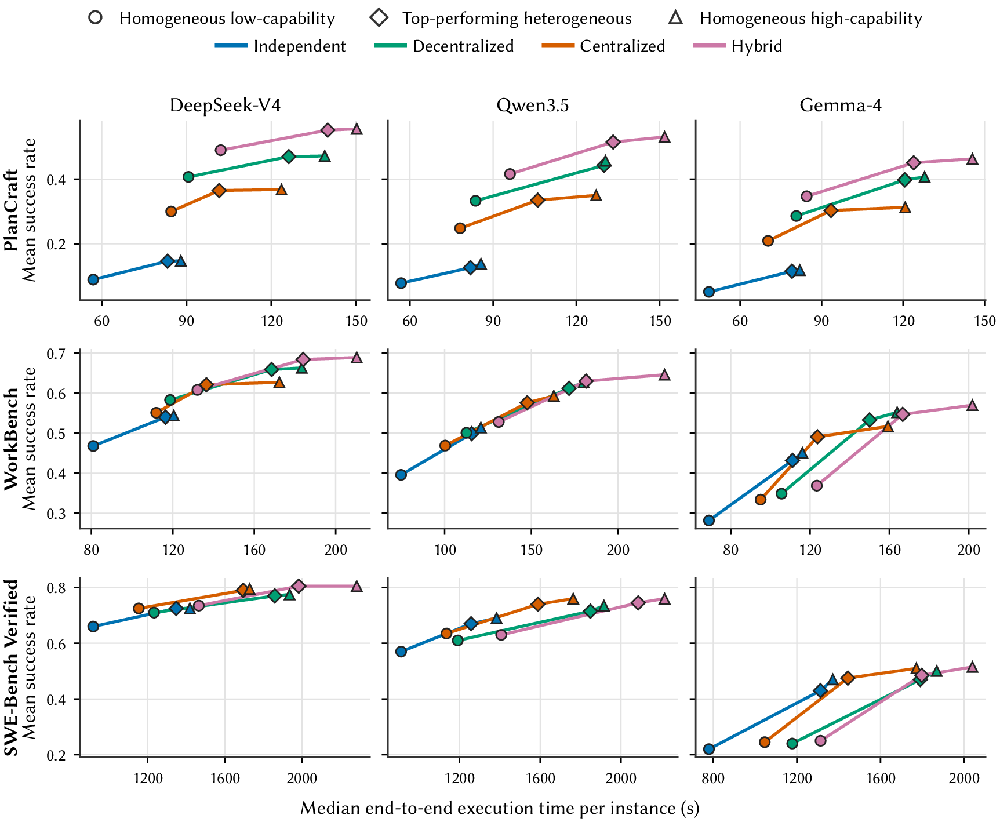
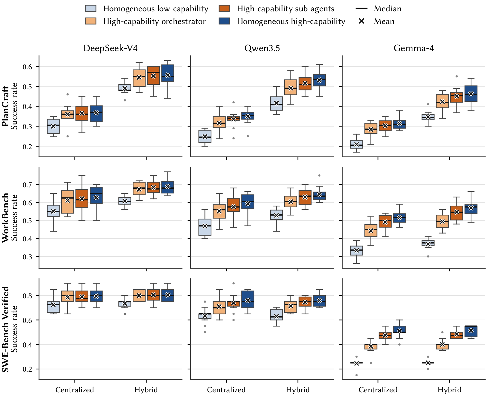

Multi-agent setups are an increasingly common way to build LLM-powered agents: several agents work in parallel, debate, or report to an orchestrator that splits up the task. Choosing among these setups is an architectural decision, with consequences for cost, latency and reliability. But unlike traditional software architecture, there is little established knowledge for reasoning about these trade-offs before deployment.

A recent study by Kim et al. compared five such architectures and concluded that their effectiveness is highly task-dependent, which suggests every new use case has to be validated empirically from scratch. That conclusion rests mainly on task success from a limited number of runs, with teams in which every agent uses the same model. We wanted to know whether broader system-level properties, such as how stable results are across repeated runs, how teams that mix models behave, and what they cost, show patterns that *do* generalize.

## What we did

We organized the study as a three-level replication of Kim et al.:

- **Direct replication (RQ1):** the original setting, Gemini 2.5 Flash on PlanCraft.
- **Conceptual replication (RQ2):** six more models from three families (DeepSeek-V4, Qwen3.5 and Gemma-4) on three benchmarks: PlanCraft, WorkBench and SWE-Bench Verified.
- **Extended replication (RQ3–RQ5):** heterogeneous teams that mix high- and low-capability models; quality of service (cost, execution time, hosted versus local inference, failures); and whether the original study's prediction function transfers to new data.

We compare five architectures (Single-Agent, Independent, Decentralized, Centralized and Hybrid) and run every configuration ten times.

## What we found

**The original ranking did not reproduce.** On PlanCraft with Gemini 2.5 Flash, Hybrid rather than Single-Agent achieved the highest mean success, and Centralized varied widely from run to run.

*Success across our ten PlanCraft runs with Gemini 2.5 Flash, compared with the values reported in the original paper.*

**Rankings hold within a benchmark, not across benchmarks.** The architecture ranking is largely consistent across models on the same benchmark, but it changes from one benchmark to another. Hybrid is in the top-ranked group in all 18 benchmark–model combinations.

**Hierarchical architectures are less stable.** Centralized and Hybrid, where an orchestrator coordinates sub-agents, vary the most between repeated runs and need the most repetitions before their average settles. Single-Agent and Independent are generally the most stable. The inference backend matters too: for the Gemma-4 models, which we ran both ways, hosted inference more than doubles run-to-run variation compared with local inference.

*Coefficient of variation of success across ten runs, by architecture, model and benchmark. Darker cells mean less stable results.*

**Mixed teams keep almost all of the performance, for less.** Teams that combine high- and low-capability models retain 97.2% of the performance of matched all-high-capability teams, while cutting reference cost by 20.2% and median execution time by 9.6%.

*Performance of the top heterogeneous team relative to the matched homogeneous high-capability team.*

The trade-off is easiest to see as curves. Each line connects three teams of one architecture: all low-capability (circle), the best mixed team (diamond) and all high-capability (triangle). A steep climb from circle to diamond followed by a nearly flat stretch to the triangle means the all-high-capability team costs more for almost no extra success. That is the pattern for most architectures with DeepSeek-V4 and Qwen3.5, where mixed teams cut cost by 30.4% and 21.8% on average. The two Gemma-4 models cost almost the same, so mixing them saves less (8.4%).

*Mean success against mean reference cost per instance. Rows are benchmarks, columns are model families, and x-axis scales differ across panels.*

Execution time tells the same story: the diamonds sit at about the same height as the triangles, but further left. Mixed teams are faster in all 36 settings, most of all in Centralized (15.5%) and Hybrid (12.7%), where replacing a high-capability model on the orchestrator's sequential path directly shortens the run.

*Mean success against median end-to-end execution time per instance, with the same layout and markers as above.*

**Put the strong model in the sub-agents.** In hierarchical architectures, giving the high-capability model to the sub-agents produces higher mean success than giving it only to the orchestrator, in all 18 within-family settings and all six cross-family settings.

*Success rates of four model assignments in Centralized and Hybrid: all low-capability, a high-capability orchestrator, high-capability sub-agents, and all high-capability.*

**Failures are slow, and prediction only goes so far.** Failed instances take 17.5% to 38.2% longer than successful ones. The original prediction function explains only a moderate share of the variation in our results (R² = 0.381), and since it gives point estimates for homogeneous teams only, it is a starting point for choosing an architecture rather than a replacement for evaluation.

## Takeaways

Task success remains partly task-dependent, but stability, model-composition and role-assignment patterns generalize across tasks, so not every architectural decision has to be re-validated from scratch. For evaluating LLM-powered agentic systems, we recommend that studies:

- report distributions over repeated runs, and check that estimates have stabilized;
- document the architecture implementation and the inference backend precisely;
- weigh task success together with cost and execution time.
