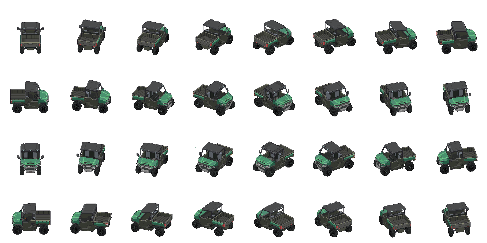

Our maze racer needs opponents. An NPC car has to drive around the track through a loop of checkpoints, three laps, without getting stuck on the snow banks. This post follows it from its first version to the one that races today, adding one piece at a time. From A* on, every stage has a short video, and the first four drive the same bend, so you can compare them.

## The car is a flat picture

Before the NPC, a word on the car itself. It isn't a 3D model. It is a sprite sheet with 32 pictures of the same vehicle, one for every 11.25° of a full turn.


*The car's sprite sheet. One picture per 11.25° of heading, 32 in all.*

We chose flat pictures over a 3D model for three reasons. They give the game its own drawn look, the same as the isometric tiles around the car. With enough angles and real physics underneath, the car still looks and moves like a 3D car as it turns and slides. And drawing one textured rectangle costs far less than a 3D car, so the game can run on almost any device.

Underneath the picture, the car is a box in a 2D physics engine, Rapier. The engine pushes the box, and the box slides on the ice and bumps into walls with real momentum. The picture only has to follow it. Every frame, the renderer reads the box's angle and picks the picture closest to it.

```js
const deltaAngle = Math.PI*2/rowNum; // rowNum = 32
let rot = this.collider._parent.rotation();
rot = rot<0?rot+Math.PI*2:rot;
this.AniIndex = (CAR_INDEX_OFFSET + Math.round(rot/deltaAngle))%CAR_MAX_IMG;
```

`CAR_INDEX_OFFSET` (28) lines the first picture in the sheet up with the physics engine's zero angle. The box's position goes through the same isometric placement as every other sprite on the map, as in our [isometric post](/work/isometric-shader/). For depth, the renderer looks up the road cells under the car's box and takes their depth, so the car slots into the map's back-to-front order with the tiles around it.

## First try: drive to the next target

The first NPC had a list of target cells and drove straight at the next one. When it reached a target, it moved on to the next. Three laps was the goal.

Driving straight at a target works on open ice, but not when a snow bank is in the way, and the car got stuck. We thought of a few quick fixes, like remembering the last state, stopping in the debugger when the car stops, and adding a random push to shake it loose. A random push would only hide the real problem, though. The car didn't know where the walls were.

## A*: a route around the walls

So the car needed a map. We turn the track into a grid where road cells are walkable and everything else is blocked, including obstacles on the road. Then the NPC plans a route to the next checkpoint with A*.

```js
const heuristic = (col,row)=>{//octile distance
    const dx = Math.abs(col-goal[0]), dy = Math.abs(row-goal[1]);
    return Math.max(dx,dy) + (Math.SQRT2-1)*Math.min(dx,dy);
};
```

The search looks at all eight neighbors. A straight step costs 1 and a diagonal step costs √2, and the octile distance above is the matching estimate of the distance left. One more rule matters a lot for a car. A diagonal step is only allowed when both cells beside it are free, otherwise the path slips through the corner of a wall.

```js
//ATTN: diagonal step needs both side cells free, otherwise it cuts the wall corner
if(!isWalkable(nCol,nRow) || (dx && dy && !(isWalkable(nCol,row) && isWalkable(col,nRow))))
    continue;
```

The first driver on top of A* was simple. It looked two cells ahead on the path and "pressed" the arrow-key direction that pointed closest to it, the way a player would.

```js
const sector = Math.round(a / (Math.PI/4)) % 8;
// ...
this.State = sectorToDir[sector];
```

<figure>
  <video src="/media/npc-racer/astar.mp4" poster="/media/npc-racer/astar.jpg" width="720" height="580" preload="none" muted loop playsinline></video>
  <figcaption>The A* stage. Blue cells are the planned path and the red cell is the next checkpoint. The car follows the path by steering in one of eight directions.</figcaption>
</figure>

The grid overlay was our first debug view. Every frame it draws the remaining path cells, the current target and the checkpoints on the map, so we could watch the plan and the car at the same time.

## PD: steering instead of key presses

Eight directions are coarse. The car can only turn in 45° steps, and since it's a physics body with momentum, a key press doesn't take into account how fast it is already moving. The next version replaced the keys with a PD controller, which works like a spring with a damper.

```js
let direction = [0,1].map(i=>
    this.positionGain*(target[i]-position[i]) - this.dampingGain*velocity[i] + repel[i]);
```

The P term pulls the car toward the target. The D term pushes against its current velocity, so the car slows down before it arrives instead of swinging past. The result is a direction that becomes the car's traction force. We use a position gain of 0.8 and a damping gain of 0.35. If the two terms ever cancel out, the car heads straight for the target so it doesn't stall.

<figure>
  <video src="/media/npc-racer/pd-astar.mp4" poster="/media/npc-racer/pd-astar.jpg" width="720" height="524" preload="none" muted loop playsinline></video>
  <figcaption>The same bend with the PD controller doing the steering.</figcaption>
</figure>

## A smoother line with a spline

A* returns cell centers, and a line through cell centers has a sharp corner at every turn. So we run a Catmull-Rom spline through the cell centers and cut each segment into ten small "micro waypoints".

```js
out.push([0,1].map(k=>0.5*(
    2*p1[k] +
    (p2[k]-p0[k])*t +
    (2*p0[k]-5*p1[k]+4*p2[k]-p3[k])*t2 +
    (3*p1[k]-p0[k]-3*p2[k]+p3[k])*t3)));
```

A Catmull-Rom curve passes through every point it's given, so the line still goes through the planned cells, only with rounded corners. To pick a target, the controller finds the micro waypoint closest to the car and aims 20 waypoints further along. Because it looks ahead, the car starts turning before it reaches the corner.

We can't see the spline in the game, so we built a line debugger for it. It draws a list of points as a polyline through the same isometric transform as the map, so the line lands on the cells it belongs to. Every frame it draws each NPC's spline and the center line of the whole race track.

<figure>
  <video src="/media/npc-racer/spline.mp4" poster="/media/npc-racer/spline.jpg" width="720" height="560" preload="none" muted loop playsinline></video>
  <figcaption>The spline stage on the same bend. Blocked cells are outlined in red, and the thin line over the path cells is the spline, drawn by the line debugger.</figcaption>
</figure>

## A fat car and whiskers

Up to here, the car was treated as a point. A real car has a width, and a line through the middle of the cells can still run close enough to a wall for the side of a wide car to hit it.

We fixed this in two ways. First, the walls get fatter before planning. Every cell whose center is closer to a wall than half the car's width, plus a 15% margin, is blocked too, so A* plans a line that leaves room for the whole car.

Second, the car got whiskers. Two rays start at its front corners and angle outward. If one of them hits a wall, the car is pushed toward the other side, and the closer the hit, the harder the push.

```js
const strength = this.repelForceMultiplier*(1-dist/this.maxWhiskerLength);
repel[0] -= sign*side[0]*strength;
repel[1] -= sign*side[1]*strength;
```

This push is the `repel` term in the PD formula above. The planned path keeps the car away from the walls most of the time, and the whiskers catch the cases the path can't, like a car sliding wide on the ice.

<figure>
  <video src="/media/npc-racer/fatcar-whisker.mp4" poster="/media/npc-racer/fatcar-whisker.jpg" width="720" height="560" preload="none" muted loop playsinline></video>
  <figcaption>The same bend again, now with a wider car, walls inflated by its width, and whiskers on.</figcaption>
</figure>

## Racing

The last step turns it into a race. The race manager builds the track's center line by running A* from each checkpoint to the next, and it measures every car's progress along that line to keep the standings, for NPCs and players alike. The NPC controller takes its numbers as parameters, so two NPCs can drive differently. One has short whiskers and gentle gains, and the other has wider, longer whiskers and stronger damping. The cars also leave a trail of smoke now.

<figure>
  <video src="/media/npc-racer/smoke.mp4" poster="/media/npc-racer/smoke.jpg" width="720" height="560" preload="none" muted loop playsinline></video>
  <figcaption>The race. The NPC car leaves a trail of smoke through the corner, and a second car pulls alongside for a moment.</figcaption>
</figure>

## What we took away

* A path from A* is not yet a line a car can drive. The spline smooths it, and the controller follows it.
* A PD controller steers with a force instead of fixed directions, and its damping keeps the car from overshooting.
* Aiming a little further down the line makes the car turn before the corner.
* Inflating the walls by the car's width keeps the planned line clear, and the whiskers handle the rest.
* The path, the target and the spline only exist as data. The grid overlay and the line debugger let us see them while the car drives.
