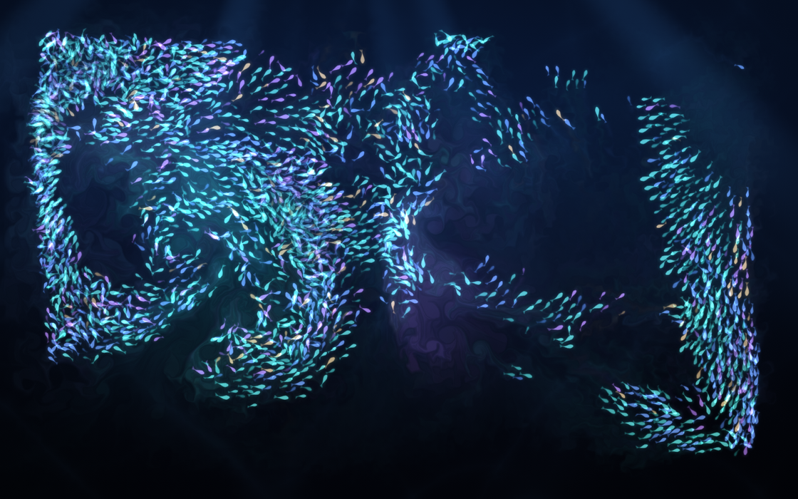
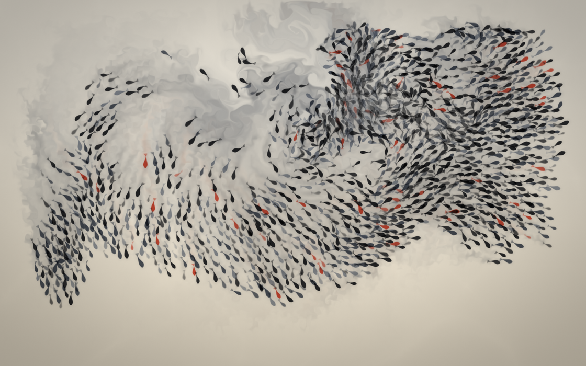
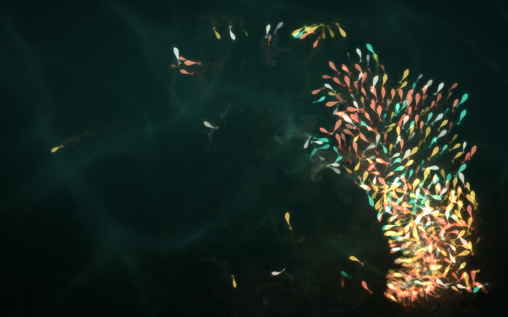

Our earlier crowd demos moved boids over a map. This time the boids live in water. A school of fish swims inside a fluid simulation, and the two affect each other. A current pushes the school around, and the school leaves a current behind it. We called it Shoal.

**[Play Shoal in your browser ↗](https://minzhenzh.github.io/WebGL-Fluid-Simulation/)** Drag to stir the water and watch the school get carried along. Press F and your cursor becomes a predator. The sliders button in the top right corner opens the settings, where you can change the school and switch between three themes.

*The water is [WebGL Fluid Simulation](https://github.com/PavelDoGreat/WebGL-Fluid-Simulation) by Pavel Dobryakov. We added the fish, the link between fish and water, and the look. The picture at the top of this page is the predator mode.*

## Two simulations in one frame

The fluid keeps its velocity in a small texture, 128 texels on the short side of the screen. Every frame it removes the part of the flow that would compress the water, and then moves the velocity and the dye along with the flow.

The boids work like the ones in our [wavefront post](/work/webgl2-wavefront-boids/). Each boid is one pixel of a texture that holds its position and velocity, and a fragment shader writes the next state into a second texture.

The order inside a frame is what ties them together.

1. The boids are drawn into two small maps, so each one can find its neighbors.
2. The boid update reads the water's velocity. This is where the water moves the fish.
3. The boids are drawn into the water as a force and as dye. This is where the fish move the water.
4. The fluid takes its step, and the frame is drawn.

## Finding neighbors without searching

A boid needs to know where its neighbors are and where they are heading. Comparing every boid with every other boid is too slow for thousands of them. So every boid is drawn as a small point into a coarse grid, with additive blending. Each cell ends up with three sums over the boids around it.

```glsl
vec2 toBoid = vCell - gl_FragCoord.xy;
float w = kernel(length(toBoid)) * vActive;
outFlock0 = vec4(w * toBoid * uCellSize, w, 0.0);
outFlock1 = vec4(w * vVel, 0.0, 0.0);
```

That is the summed weight, the summed position and the summed velocity. Dividing the last two by the weight gives the center of the neighbors and their average velocity. A boid steers toward the center to stay with the group, and matches the average velocity to swim the same way.

Our first version read only the cell a boid was standing in. Every boid in that cell got the same center, steered to the same point, and the school collapsed onto the grid like beads on a net. Now a boid blends the four cells around it, so the answer changes smoothly as it moves.

## Keeping a body length apart

Staying together is half of it. The fish also need room. For that there is a second, finer map, where one cell is about a third of a fish. The same three sums give the push away from close neighbors in one line.

```glsl
vec2 push = (n.z * (nearPos - nearCentre) - n.xy) / (KERNEL_RADIUS * uNearCellSize);
steer += uSeparation * SEPARATION_ACCEL * push / (1.0 + length(push));
```

`n.z` is the summed weight and `n.xy` is the summed position, measured from the cell's center. Together they add up the push from every close neighbor without visiting any of them.

This worked, but dense schools lined up in neat horizontal rows. The grid was showing through. The fix was small. Every frame the fine grid is moved by a random fraction of a cell before the boids are drawn into it, and the rows disappeared.

## The water carries the fish

In the update shader, each boid looks up the water's velocity under itself and is dragged toward it.

```glsl
water = texture(uFluid, pos / uWorld).xy * uFluidScale;
// ...
vec2 drag = uDrag * (water - vel);
```

`uDrag` is the drag coefficient from the settings. With a value of 1.5, a boid needs about two thirds of a second to pick up the speed of a current. With 0 it ignores the water completely.

One detail made a big difference. A fish swims through the water, not over the ground. So we measure its swimming speed against the water around it, and we draw its body pointing the way it swims. When a strong current sweeps the school sideways, the fish are carried along while still facing where they are trying to go.

## The fish move the water

The fluid already has a way to add a force, the splat that runs when you drag the mouse. But every splat is a pass over the whole screen, and three thousand of them per frame is far too many.

So the boids are drawn again, all in one draw call, as small soft points with additive blending. This time they go into a force texture the same size as the water's velocity. One extra pass then adds that texture to the velocity. A second draw call puts a little dye behind each tail, in that fish's own color. The fluid carries the dye away and fades it like any other dye, and that is how the school paints its path into the water.

How hard should a fish push? If every fish always pushed forward, a school would speed its own water up, the faster water would carry the school faster, and so on. So a fish only pushes until the water moves with it at "wake speed", and then it stops.

```glsl
float wakeSpeed = uWakeSpeed * swimSpeed;
float remaining = clamp(1.0 - dot(water, dir) / max(wakeSpeed, 1e-4), 0.0, 1.0);
// ...
vPush = dir * wakeSpeed * remaining * uGain * share * activeWeight(uint(gl_VertexID));
```

`share` divides the push among fish that are crowded onto the same spot. We checked the result with the background currents switched off. With the fish pushing, the water moves at about 4 texels per second on average. With three times the force, or with ten thousand fish, even the fastest spot stays under 40. And if the push is turned off in the settings, the water stays at exactly zero.

## A predator

In predator mode the cursor leads one large fish. It follows the cursor like a weight on a spring, so it glides instead of jumping. Any boid that comes too close turns straight away from it and swims up to two and a half times faster. The predator stirs the water as it moves, using the fluid's ordinary splat, and leaves a trail in its own color.

The school does the rest. It opens into a ring around the predator, and the ring closes again behind it.

## Three themes

Every color comes from a theme, which is a short list in one file. It holds the water's colors, a tint for the light, and four dye colors with a weight each, so one color leads and the others are rare.


*Abyssal glow, the default. Three thousand fish in cyan, blue and violet, with a few amber ones.*

In the first and third theme the dye is light, added on top of dark water. The ink theme turns that around. The dye texture stores how much light the ink takes away, and the paper is darkened by it.

```glsl
vec3 color = bg * (1.0 + light) * exp(-ink);
```

Nothing else in the simulation changes. The same fish and the same water now read as ink on paper.


*Sumi-e ink. The trails become gray washes, and a few fish are vermilion.*


*Night koi pond. Fewer and larger fish, in warm colors over dark green water.*

## Fish, not triangles

Each fish is a short ribbon of triangles along its body, drawn once for every boid. The vertex shader bends it.

```glsl
float wave = sin(phase - s * 4.5) * tail * (0.04 + 0.07 * speedFactor);
float bend = clamp(turn * 0.11, -0.35, 0.35) * tail;
```

`s` runs from the nose to the tail. The wave travels down the body and gets wider when the fish swims faster. The bend follows how fast the fish is turning, so the tail trails toward the inside of a turn, along the path the head just took. A few fish are drawn smaller, dimmer and softer, as if they were deeper in the water.

Packed schools used to burn out to white, because every fish adds its light to the ones under it. Now a fish gives a little less light where the school is very dense, and a tight ball keeps its color.

## What it costs

We measured the time for one frame on a MacBook Air with an M4 chip, on a canvas of 2048 by 1536 pixels. This is the cost of a frame, not the frame rate on screen. A 60 Hz display leaves 16.7 ms.

| Fish | Time per frame |
|---|---|
| none | 4.9 ms |
| 3,000 | 5.4 ms |
| 10,000 | 5.8 ms |
| 16,384 | 5.9 ms |

The whole school costs between half a millisecond and one millisecond, however large it is. Most of the frame goes to the fluid and to drawing the final picture.

## What we took away

* Drawing the boids into a grid replaces the neighbor search. The same trick, pointed at the water's textures, is what lets the fish push the water.
* Reading one grid cell hands every boid in it the same answer. Blending the cells around a boid, and moving the fine grid a little every frame, hides the grid.
* A fish swims through the water, so its speed and its heading are measured against the water around it.
* A fish stops pushing once the water moves with it. That keeps the school and the water from speeding each other up.
* Treating the dye as ink instead of light gave a second look without touching the simulation.
