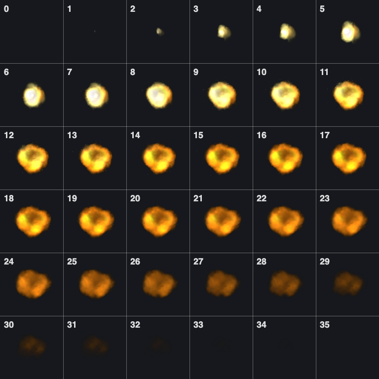
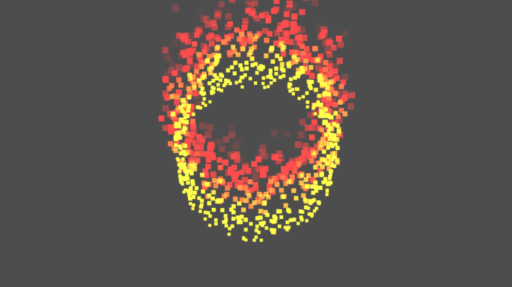

Blast is one of the small demos in our WebGL1 engine. It is a ring of fire puffs. Each puff grows, flickers through a little fire animation, fades out, and comes back.

<figure>
  <video src="/media/webgl-blast-texture-atlas/blast.mp4" poster="/media/webgl-blast-texture-atlas/blast.jpg" width="1280" height="720" preload="none" muted loop playsinline></video>
  <figcaption>The blast demo running in the browser.</figcaption>
</figure>

There is no video file and no sprite per frame here. The whole animation lives in one image, and the GPU picks the right piece of it for every particle, every frame. This post is about how we got there, step by step.

## Starting with a strip

When we started the particle work in November 2024, we borrowed the layout of the classic particle system from Google's old WebGL samples. Every particle was a small quad that always faced the camera, and its texture was a single row of frames, a "strip".

To check that frames were really changing, we used a test strip with the numbers 0 to 7 on it. If the particle showed "3" when we expected "3", the math was right.


*Our debug strip: eight 32 × 32 frames side by side. Much easier to check than real fire.*

With a strip, picking a frame only touches the u coordinate. Time tells us which frame we are on, and the frame tells us how far to slide along the strip:

```glsl
float frame = mod(floor(localTime / frameDuration + frameStart), numFrames);
float uOffset = frame / numFrames;
float u = uOffset + (uv.x + 0.5) * (1. / numFrames);
outputTexcoord = vec2(u, uv.y + 0.5);
```

That worked, but a quad means four corners per particle, and we had to turn each one to face the camera ourselves.

## Points instead of quads

WebGL can draw a particle as a single point. You draw with `gl.POINTS`, set `gl_PointSize` in the vertex shader, and the GPU gives the fragment shader a square sprite with `gl_PointCoord` running from 0 to 1 across it. It always faces the camera for free.

So the quad went away. One vertex per particle, and that vertex only needs two numbers: when the particle starts, and which particle it is.

```glsl
attribute float aStartTime;
attribute float aParticleID;
```

Everything else, like where the particle sits and how big it gets, we read from textures. More on that below.

## A real fire sheet is a grid

The digits were fine for testing, but real effects come as sprite sheets laid out in a grid. Our fire sheet is 768 × 768 pixels with 128 pixel tiles, so 6 × 6 = 36 frames. Read it like a book: left to right, then the next row.


*The fire atlas with frame numbers added. Frame 0 is empty, the puff peaks around frame 9, and it is gone by frame 33.*

Now a frame number has to become a column and a row. We wrote a little helper for it and keep it in its own file, `aniTex.glsl`, so any shader can `#include` it:

```glsl
uniform vec4 _ANI_TEX_0;      // texWidth, texHeight, tileSize, numFrames
uniform float _ANI_TEX_0_FPS;
varying vec4 _ANI_TEX_UV;     // tile corner uv, numCols, numRows

void _GEN_ANI_TEX_UV(float texWidth, float texHeight, float tileSize, float frame){
  float numCols = texWidth / tileSize;
  float numRows = texHeight / tileSize;
  float row = floor(frame / numCols);
  float col = mod(frame, numCols);

  _ANI_TEX_UV = vec4(col / numCols, row / numRows, numCols, numRows);
}
```

It doesn't sample anything. It just works out where the tile starts and how big a tile is, and hands that to the fragment shader through a varying.

## Every particle has its own clock

Each particle keeps its own time. We subtract its start time from the global time and wrap it by the lifetime. From that we get two things:

* `percentLife`, from 0 to 1, which drives the size
* `frame`, which drives the animation

```glsl
float frameDuration = 1.0 / _ANI_TEX_0_FPS;

float localTime = mod(uTime - aStartTime, uLifeTime);
float percentLife = localTime / uLifeTime;
float frame = mod(floor(localTime / frameDuration), numFrames);

_GEN_ANI_TEX_UV(texWidth, texHeight, tileSize, frame);

float size = mix(startSize, endSize, percentLife);
gl_PointSize = size;
```

Notice the frame comes from its own frames per second, not from the lifetime. A puff lives for 10 seconds, but the fire animation plays at 36 fps, so it loops about once a second. That gives the flicker you see in the video. If you want one animation per life, divide by the lifetime instead.

Since every particle starts at a different time, they are all on different frames. That is what stops the ring from blinking in sync.

## Picking the pixel

The fragment shader has the tile corner and the tile count. `gl_PointCoord` tells us where we are inside the point. Divide it by the number of columns and rows to squeeze it into one tile, then add the corner:

```glsl
vec2 pointUV = _ANI_TEX_UV.xy;
float numCols = _ANI_TEX_UV.z;
float numRows = _ANI_TEX_UV.w;
vec2 pointCoord = pointUV + vec2(gl_PointCoord.x / numCols, gl_PointCoord.y / numRows);

gl_FragColor = texture2D(uColorSampler, pointCoord);
```

That's the whole trick. One texture fetch per pixel and no branching.

## Where the puffs come from

The particle positions don't come from vertex attributes. We bake them into a small float texture, two pixels per particle. The first pixel is position plus start size, the second is velocity plus end size:

```js
const angle = Math.random() * 2 * Math.PI;
const x = Math.cos(angle) * radius;
const y = Math.sin(angle) * radius;

posPixels.push(x, y, 0.0, startSize);   // pixel one
posPixels.push(tangentX * speed, tangentY * speed, 0.0, endSize);   // pixel two
```

The vertex shader looks up its two pixels with `aParticleID`, so changing the shape of the effect is just a matter of filling the texture differently. For blast it's a ring with radius 50.

Before the atlas, this is what that ring looked like. Each particle was a flat quad colored by a ramp texture that goes from yellow to red to black:


*An earlier version from late November 2024: positions from a texture already, but no animation yet.*

## Wiring it up

On the JavaScript side, the material only needs to know how the atlas is cut:

```js
const particleMaterial = new _particleMaterial('particleMat', {
    shader: particleShader,
    tileSize: 128,
    texWidth: 768,
    texHeight: 768,
    numFrames: 36,
    aniFps: 36,
    partiCount,
    ...particleParams,
});
```

And we draw with additive blending, so overlapping puffs get brighter instead of covering each other. A nice side effect: with additive blending the draw order doesn't matter, so we never have to sort particles.

```js
gl.enable(gl.BLEND);
gl.blendFunc(gl.SRC_ALPHA, gl.ONE);
gl.blendEquation(gl.FUNC_ADD);
```

## What we took away

* A texture atlas plus a frame number is all you need for animated sprites. The shader math is a handful of lines.
* Test with digits first. A numbered atlas makes off by one mistakes obvious.
* Give the animation its own fps. Tying it to the lifetime looks very different, and it's good to be able to choose.
* Keep the per particle data in textures. The vertex can stay tiny, and the same shader works for any shape you can write into a texture.

In the [snow post](/work/webgl-snow-framebuffer-solver/) we take the next step: instead of baking where particles go, we let the GPU simulate them.
