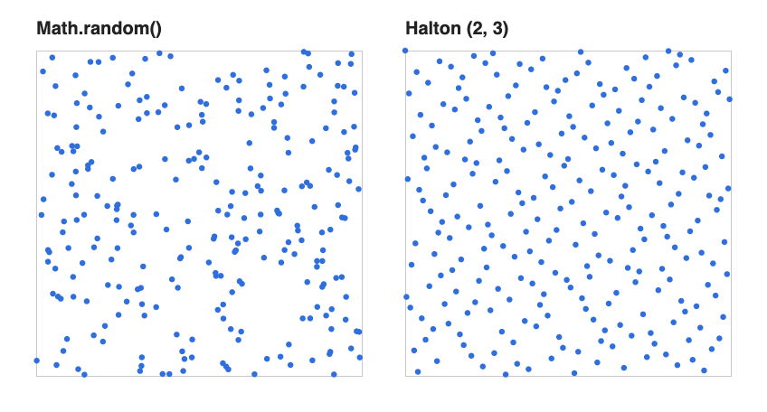
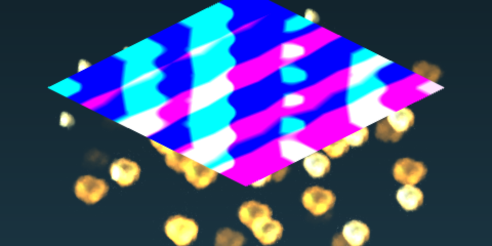
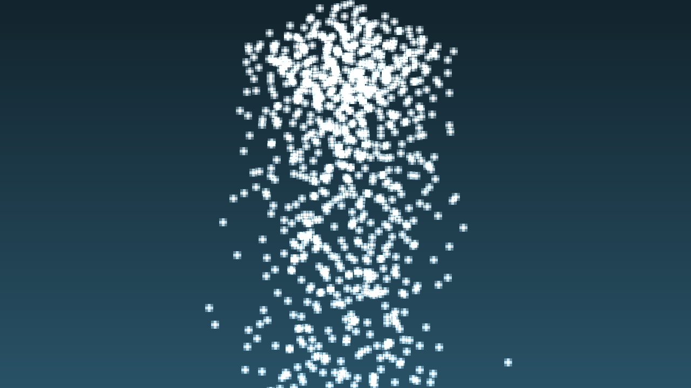
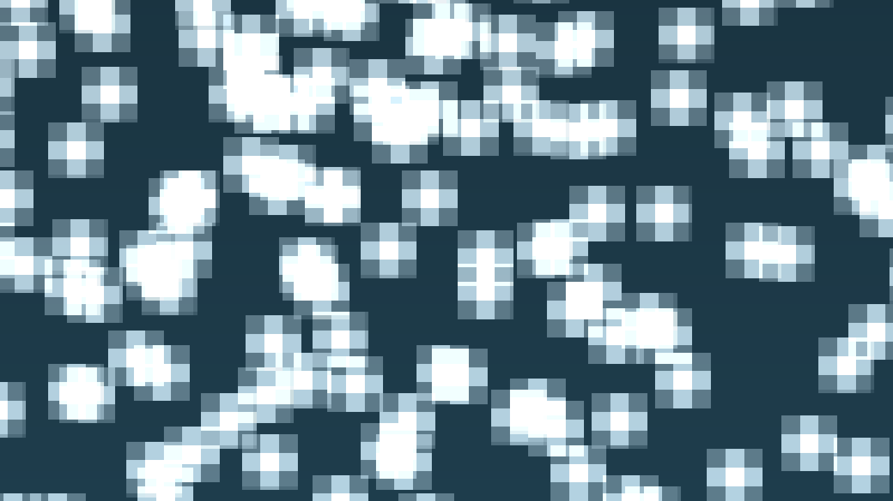

Snow is the default demo in our WebGL1 engine. On screen it's simple: a patch of sky drops a thousand chunky snowflakes that drift, swirl a little and fall.

<figure>
  <video src="/media/webgl-snow-framebuffer-solver/snow.mp4" autoplay muted loop playsinline></video>
  <figcaption>The snow demo. Every flake is updated on the GPU, every frame.</figcaption>
</figure>

Under the hood it's a small physics solver that runs entirely inside a fragment shader. This post walks through how we built it.

## Why blast wasn't enough

In the [blast post](/work/webgl-blast-texture-atlas/) the particles never really move on their own. We know where a puff starts and how fast it goes, so its position at any time is just `start + velocity * time`. The shader can work that out from scratch every frame.

Snow is different. A flake gets pulled by gravity, pushed by wind, nudged by noise and slowed by air. Where it is now depends on where it was a moment ago. So we need to *remember* every flake between frames, and update it step by step.

On the CPU that's an easy loop. But we wanted it on the GPU, and WebGL1 has no compute shaders and no transform feedback. What it does have is textures and fragment shaders.

## Textures as memory

The idea, which we first read about in skeeto's [A GPU Approach to Particle Physics](https://nullprogram.com/blog/2014/06/29/) and nopjia's [MRT Particles](http://nopjia.blogspot.com/2014/06/webgl-gpu-particles.html), goes like this:

* Store each particle in one pixel of a float texture. With the `OES_texture_float` extension a pixel holds four real floats, not four bytes.
* To update the particles, draw a full screen quad into a framebuffer that is the size of that texture. The fragment shader runs once per pixel, which means once per particle.
* That fragment shader reads the old state, does the physics, and writes the new state.

One catch: you can't read from a texture while you're writing into it. So we keep two framebuffers and swap them every frame. Read from one, write into the other, swap. This is the famous ping-pong.

```js
update(gl){
    gl.viewport(0, 0, this.width, this.height);
    this.attach(gl);   // write into the front buffer

    this.material[0].setTexture('uDataSlot0', this.backBuffer.textures[0]);   // read the back one
    this.material[0].setTexture('uDataSlot1', this.backBuffer.textures[1]);
    this.material[0].setTexture('uDataSlot2', this.backBuffer.textures[2]);
    this.material[0].setTexture('uDataSlot3', this.backBuffer.textures[3]);

    this.material[0].preDraw(gl);
    this.shape[0].draw(gl, this.material[0]);   // the full screen quad
    this.material[0].postDraw(gl);

    this.swap();
    this.detach(gl);
}
```

## One texture is not enough

A flake needs more than four numbers. Position, size, velocity, how far into its life it is, a color. We could run the solver several times with one output each, but WebGL1 has an extension for this: `WEBGL_draw_buffers` lets one draw call write into several textures at once.

Our very first solver shader, from December 2024, did nothing but check that this worked. It wrote a fixed color into each of the four outputs:

```glsl
//STEP one
gl_FragData[0] = vec4(0.25,0,0,1);
gl_FragData[1] = vec4(0,0.5,0,1);
gl_FragData[2] = vec4(0,0,0.75,1);
gl_FragData[3] = vec4(1.0,0,0,1);
```

When four textures came back in four different colors, we knew the plumbing was right. The framebuffer class attaches four float textures and turns on all four outputs:

```js
gl.framebufferTexture2D(gl.FRAMEBUFFER, ext.COLOR_ATTACHMENT0_WEBGL, gl.TEXTURE_2D, this.textures[0].texture, 0);
// ... same for attachments 1, 2 and 3
ext.drawBuffersWEBGL([
    ext.COLOR_ATTACHMENT0_WEBGL, // gl_FragData[0]
    ext.COLOR_ATTACHMENT1_WEBGL, // gl_FragData[1]
    ext.COLOR_ATTACHMENT2_WEBGL, // gl_FragData[2]
    ext.COLOR_ATTACHMENT3_WEBGL  // gl_FragData[3]
]);
```

Today every flake has four slots:

* slot 0: position xyz and size
* slot 1: velocity xyz and generation
* slot 2: angular velocity, percent of life
* slot 3: color

## Which pixel is which flake

Snow uses 32 × 32 = 1024 flakes, so the solver textures are 32 × 32. A particle ID maps to a pixel by row and column. The solver goes from pixel to ID:

```glsl
float getPID(vec2 fragCoord, float uMAXCOL){
    return (uMAXCOL-1.0-floor(fragCoord.y)) * uMAXCOL + floor(fragCoord.x);
}
```

And the particle renderer goes the other way, from ID to the center of the pixel:

```glsl
vec2 getSolverCoord(float pid, float uMAXCOL){
  vec2 uv =  vec2(mod(pid,uMAXCOL), floor(pid/uMAXCOL)) / uMAXCOL;
  uv += vec2(1.0/uMAXCOL*0.5); //offset to center of pixel
  return uv;
}
```

That half pixel offset matters. Without it you sample right on the edge between two pixels and can end up reading a neighbor's data.

## Where flakes are born

Flakes spawn from a 16 × 16 square floating above the scene. The spawn data also lives in textures, which we call emitter slots. Each pixel says where a flake starts and when it's allowed to start.

For the start points we first used `Math.random()`. The problem with random points is that they clump together and leave holes. So in February 2025 we switched to a Halton sequence, which fills the square much more evenly:


*The same number of points, random on the left and Halton (bases 2 and 3) on the right.*

```js
const haltonX = halton(2, row * MAXCOL + col);
const haltonY = halton(3, row * MAXCOL + col);
const localX = localXStart + haltonX * scale;
const localZ = localYStart + haltonY * scale;
const startTime = (row * MAXCOL + col) * duration / partiCount;
posPixels.push(localX, localZ, size, startTime);
```

The start times are spread over the duration, so flakes come out a few at a time instead of all at once. If you draw an emitter texture straight onto a quad you get this colorful mess, which is honestly just a picture of numbers:


*An emitter texture drawn as color, from the fire demo, which uses the same emitter. Red and green are the spawn position and blue is the size. The start time sits in alpha, so you can't see it here.*

## Born, live, repeat

Every flake lives for `uLifeTime` seconds and then starts over. To notice the restart, the solver counts lives as a *generation*, and keeps the last one in slot 1. When the generation changes, it's time to respawn. Otherwise we integrate:

```glsl
int lastGene = int(texture2D(uDataSlot1, uv).w);
int generation = uTime - startTime > 0.0 ? int(mod(floor((uTime - startTime)/uLifeTime), float(GEN_SIZE))) : -1;

bool emit = generation != lastGene;
if(emit || uState == 1){
    // read the emitter slots, put the flake back at the top
    pos = (uEmitterTransform * vec4(emitterPos.x, 0, emitterPos.y, 1)).xyz;
    linVel = vec3(0);
} else {
    pos = texture2D(uDataSlot0, uv).xyz;
    vec3 oldVel = texture2D(uDataSlot1, uv).xyz;
    // forces go here
    updatePosVel(pos, linVel);
}

gl_FragData[0] = vec4(pos, size);
gl_FragData[1] = vec4(linVel, generation);
```

`uState == 1` is the init mode. On the very first frame there is no old state to read, so everything spawns. After one frame the demo switches the solver to play mode.

## Forces

The fun part. In March 2025 we added gravity, and in April a vortex, noise and damping. Each one is a tiny function:

```glsl
vec3 gravityField(vec3 linVel, vec3 gravity) {
    return linVel + gravity * uDeltaTime;
}

vec3 vortexField(vec3 pos, float scalar){
    return vec3(-pos.z, 0, pos.x) * scalar;
}

vec3 noiseField(vec3 pos, vec3 scalar) {
    float x = fract(sin(dot2(pos.xy,vec2(12.9898,78.233)))* 43758.5453)-0.5;
    float y = fract(sin(dot2(pos.xy,vec2(62.2364,94.674)))* 62159.8432)-0.5;
    float z = fract(sin(dot2(pos.xy,vec2(989.2364,94.674)))* 12349.8432)-0.5;
    return scalar*normalize(vec3(x,y,z));
}
```

Each field has an on/off switch, and all of them are packed into one uniform array, `uFieldParams`. The demo rebuilds it every frame from a plain JS object:

```js
const fieldParams = [];
fieldParams[0] = [ solverParams.gravitySwitcher, ...solverParams.gravity ];
fieldParams[1] = [ solverParams.vortexSwitcher, solverParams.vortexScalar, 0, 0 ];
fieldParams[2] = [ solverParams.noiseSwitcher, ...solverParams.noiseScalar ];
fieldParams[3] = [ solverParams.dampSwitcher, solverParams.dampScalar, 0, 0 ];
solverMaterial.setUniform('uFieldParams', fieldParams.flat());
```

Because `solverParams` is on `window`, you can play with the weather from the browser console while it runs. Here's the same snow with only gravity, next to all four fields:


*Gravity only: `solverParams.vortexSwitcher = 0; solverParams.noiseSwitcher = 0; solverParams.dampSwitcher = 0`. Nothing slows the flakes down, so they speed up and the column thins out.*


*All four fields on, the default. Damping keeps the flakes slow, so more of them hang in the air, and the vortex and noise give them a little wobble on the way down.*

## Drawing the flakes

Rendering is the easy half. Each flake is one point, and its vertex shader reads the position straight out of the solver texture:

```glsl
vec2 solverCoord = getSolverCoord(aParticleID, uMAXCOL);
vec3 position = texture2D(uDataSlot0, solverCoord).xyz;
vSize = texture2D(uDataSlot0, solverCoord).w;

gl_Position = _uni_projMat * _uni_viewMat * _uni_modelMat * vec4(position,1);
gl_PointSize = vSize;
```

In late April 2025 we went for pixel art snow instead of soft blobs. The fragment shader snaps `gl_PointCoord` to a small grid before measuring the distance to the center. With `uPixelNum = 4` each flake becomes a tiny chunky disc:

```glsl
float pixelNum = uPixelNum / 2.0;
vec2 p = floor((2.0 * (gl_PointCoord - 0.5))*pixelNum)/pixelNum;
float dist = length(p);

if(vSize>1.0 && dist < uRadius) {
    float alpha = dist < uBlurRadius ? 1.0 : smoothstep(1.0, uBlurRadius, dist);
    gl_FragColor = vec4(vColor, alpha);
} else {
    discard;
}
```


*Up close. Each flake is a 20 pixel point snapped to a 4 × 4 grid.*

## What we took away

* A framebuffer plus a fragment shader is a perfectly good compute shader, as long as your data fits in pixels.
* Ping-pong is not optional. Two buffers, read one, write the other, swap.
* `WEBGL_draw_buffers` saves a lot of passes. Test it with flat colors before you trust it.
* Use a low discrepancy sequence like Halton for spawn points. It looks better than random for free.
* Put the knobs on `window`. Tweaking forces live in the console taught us more than any amount of reading the shader.

Later we ported the same ideas to WebGL2, where transform feedback can do the update without the texture tricks. But this framebuffer version is the one that taught us how it all fits together.
