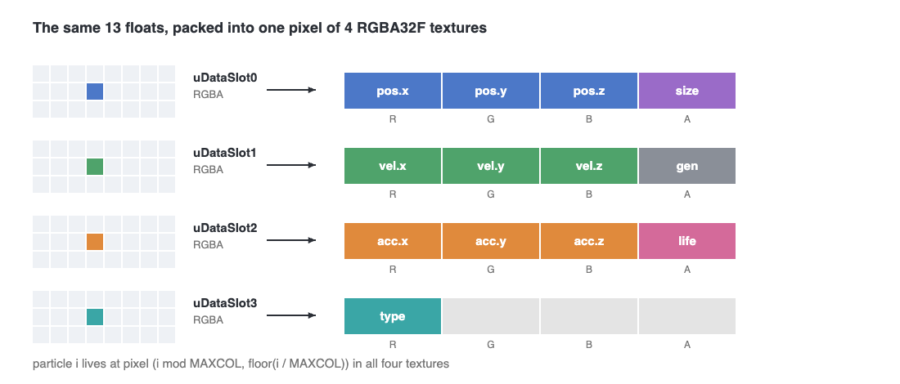

In the [transform feedback post](/work/webgl2-transform-feedback-particles/) every particle was a vertex, and the vertex shader wrote the next frame straight back into a buffer. This time we keep every shader, every force and every sprite sheet exactly the same, and only change *where* a particle lives.

<figure>
  <video src="/media/webgl2-framebuffer-particles/tf-vs-fb.mp4" poster="/media/webgl2-framebuffer-particles/tf-vs-fb.jpg" width="1280" height="720" preload="none" muted loop playsinline></video>
  <figcaption>The leaves demo. Left: transform feedback. Right: framebuffer. Same emitter, same forces, same sheet.</figcaption>
</figure>

## Why go back to textures?

In WebGL1 we had no choice. Our [WebGL1 snow](/work/webgl-snow-framebuffer-solver/) kept particles in float textures because that was the only memory a shader could write to. In WebGL2 we have transform feedback, so why bother?

Two reasons. First, our flow field and boids work was already running on a framebuffer solver called `FrameSolver`, which we built in December 2025 for a grid based wavefront. It would be nice to have one way of doing things. Second, and more important: in the transform feedback solver a particle only gets its own attributes, because everyone else is in a buffer the shader can't read. In the framebuffer solver the whole state is a texture, so a particle can look at any other pixel. That matters as soon as particles have to react to each other.

So we wanted every particle demo to run on both solvers, and to be able to flip between them with one switch.

## What WebGL2 makes easier

The idea is the same as in WebGL1, but a few annoying parts are gone:

* Multiple render targets are built in. We call `gl.drawBuffers` directly instead of going through the `WEBGL_draw_buffers` extension.
* The shader declares its outputs as a normal array, `out vec4[4] fragData`, instead of the old `gl_FragData`.
* Float textures are real `RGBA32F`, and with `EXT_color_buffer_float` we can render into them.

The framebuffer setup ends with:

```js
gl.drawBuffers([
    gl.COLOR_ATTACHMENT0, // gl_FragData[0]
    gl.COLOR_ATTACHMENT1, // gl_FragData[1]
    gl.COLOR_ATTACHMENT2, // gl_FragData[2]
    gl.COLOR_ATTACHMENT3, // gl_FragData[3]
]);
```

## 13 floats, 4 pixels

A transform feedback particle is 13 floats in a row. A texture pixel holds 4. So each particle gets one pixel in each of four textures, at the same spot:


*The same 13 floats as in the transform feedback layout, split into one RGBA pixel in each of four textures.*

Position, velocity and acceleration each take three channels, and the leftover fourth channels hold size, generation and frameLife. Only `aniType` needs a fourth texture, and three channels of it are spare.

The texture is `MAXCOL × MAXCOL` pixels, so the particle count has to be a perfect square. Rain, leaves, flowers and arrows already were. Snow used 1000 particles, so we bumped it to 32 × 32 = 1024 to give both solvers exactly the same particles.

## Porting the solver

The transform feedback solver is a vertex shader, `solver-vert.glsl`. The new one is a fragment shader, `particleSolver-frag.glsl`, and most of it is a straight copy: the same uniforms, the same force functions, the same spawn logic. Only the beginning and the end change.

At the beginning, the particle ID used to be `gl_InstanceID`. Now the pixel *is* the particle, and its spot in the state textures is also its spot in the emitter textures:

```glsl
vec2 emitterUV = gl_FragCoord.xy / uMAXCOL;

vec4 dataSlot0 = texture(uDataSlot0, emitterUV);
vec4 dataSlot1 = texture(uDataSlot1, emitterUV);
vec4 dataSlot2 = texture(uDataSlot2, emitterUV);

vec3 pos = dataSlot0.xyz;
vec3 linVel = dataSlot1.xyz;
vec3 acc = dataSlot2.xyz;
float size = dataSlot0.w;
float frameLife = dataSlot2.w;
float lastGene = dataSlot1.w;
```

That's nicer than our WebGL1 version, which had to flip rows to turn `gl_FragCoord` into an ID. Here we never need the ID at all.

At the end, instead of `out` variables captured by transform feedback, we write the four pixels:

```glsl
fragData[0] = vec4(pos, size);
fragData[1] = vec4(linVel, generation);
fragData[2] = vec4(acc, frameLife);
fragData[3] = vec4(aniType, 0, 0, 1);
```

Everything in between, spawning, gravity, vortex, noise, damping, turbulence and the acceleration driven `frameLife`, is untouched. That was the point: if the two solvers share the logic line for line, any difference you see between them is a bug.

## Drawing from textures

The fragment shaders for snow, rain, leaves and arrows don't change either. Only the vertex shaders do. Each one gets a small framebuffer twin that reads its particle out of the textures by `gl_InstanceID`:

```glsl
vec2 getParticleCoord(float particleID, float MAXCOL) {
    vec2 uv = vec2(mod(particleID,MAXCOL), floor(particleID/MAXCOL))/MAXCOL;
    uv += vec2(1.0/MAXCOL*0.5);    //  offset to center of pixel
    return uv;
}

void main()
{
    vec2 particleUV = getParticleCoord(float(gl_InstanceID), uMAXCOL);
    vec4 dataSlot0 = texture(uDataSlot0, particleUV);
    vec4 dataSlot1 = texture(uDataSlot1, particleUV);

    gl_Position = _uni_projMat * _uni_viewMat * _uni_modelMat * vec4(dataSlot0.xyz, 1.0);
    gl_PointSize = dataSlot0.w;
    vGeneration = dataSlot1.w;
}
```

The leaves version also reads `frameLife` and `aniType` from the other two textures and passes them on, and the sprite sheet code is the same as before.

## One switch

Each demo now asks a small helper for its solver, and the helper builds whichever one you picked:

```js
const {solver, solverMaterial, solverShape} = initParticleSolver(gl, solverType, {
    count: particleParams.count, stride: STRIDE
});
```

Both solvers read the same uniforms, so the rest of the demo, the emitter textures, the force fields and the draw loop, sets them up the same way and never has to know which one it got. The only extra step for the framebuffer version is handing the latest textures to the particle material before drawing. In the browser it's just `?demo=leaves&solver=fb`, or a dropdown.

## So which one?

After running them side by side for a while, this is how we think about it:

* **Transform feedback** fits particles best when each one only cares about itself. A particle is a vertex, the layout is any struct you like, the count can be any number, and there is no texture size to worry about.
* **Framebuffers** win when particles need to see each other, or other grids. The whole state is a texture, so any pass can sample it: neighbors, a flow field, a density map. It's also easy to debug, because you can just draw the state textures on screen.

In the video above you can't tell them apart, and that's the result we wanted. Next we want to try the case where the framebuffer version should really shine: particles that react to their neighbors.
