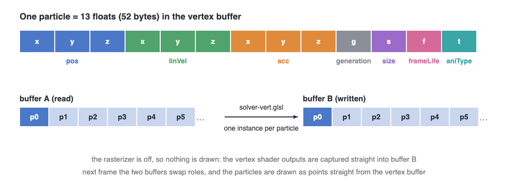
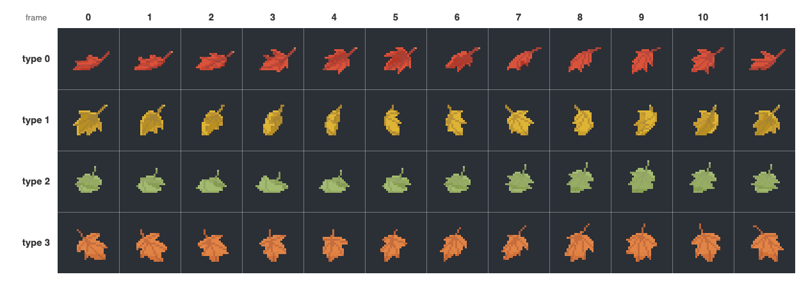
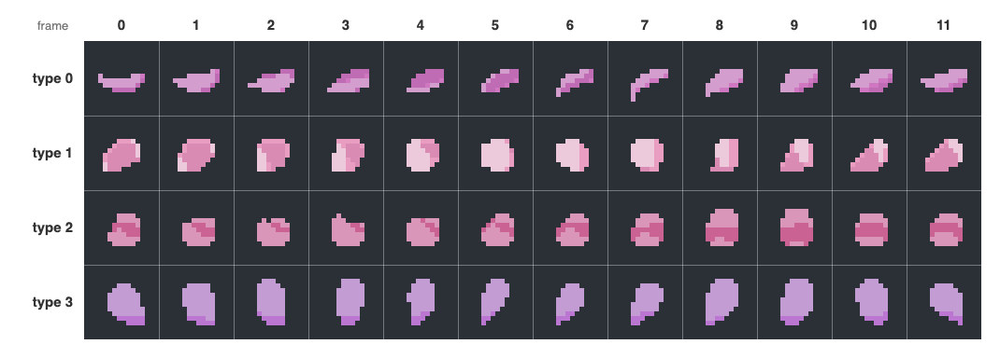

These are the four effects in the WebGL2 version of our engine. Every particle in them is simulated on the GPU, and the CPU never touches a single position.

<figure>
  <video src="/media/webgl2-transform-feedback-particles/tf-overview.mp4" poster="/media/webgl2-transform-feedback-particles/tf-overview.jpg" width="1280" height="720" preload="none" muted loop playsinline></video>
  <figcaption>Snow, rain, leaves and flowers, each running in its own page and recorded side by side.</figcaption>
</figure>

In the WebGL1 version we [kept particles in textures](/work/webgl-snow-framebuffer-solver/) and updated them with a fragment shader. It worked, but it always felt like a trick. A particle is not really a pixel. WebGL2 gave us a more natural tool, and this post is about how we used it.

## Learning the new tool

We moved the engine to a WebGL2 context in May 2025. The first thing we did was not write any particles. We worked through a few small WebGL2 samples instead: instanced drawing, sampler wrapping, and one called *transform feedback interleaved*. That last one is the whole idea of this post in about a hundred lines.

Transform feedback lets you record what a vertex shader outputs. Normally those outputs go to the rasterizer and become pixels. With transform feedback turned on, they get written into a buffer instead. So if the vertex shader reads a particle, moves it a little, and outputs it again, the buffer now holds the next frame.

## One particle, 13 floats

First we decided what a particle is. It ended up being 13 floats packed together:


*One particle is 52 bytes in a vertex buffer. Each frame we read buffer A and write buffer B.*

In the shader these are plain vertex attributes, one per field:

```glsl
#buffer aPos:particleBuffer, size:3, stride:52, offset:0
layout(location = POSITION_LOCATION) in vec3 aPos;

#buffer aLinVel:particleBuffer, size:3, stride:52, offset:12
layout(location = LINEAR_VELOCITY_LOCATION) in vec3 aLinVel;

#buffer aAcc:particleBuffer, size:3, stride:52, offset:24
layout(location = ACCELERATION_LOCATION) in vec3 aAcc;
// ... generation, size, frameLife, aniType
```

The `#buffer` lines are read by our own GLSL plugin, so the JavaScript side knows the stride and offsets without us typing them twice. The outputs are the same fields again, `vPos`, `vLinVel`, `vAcc` and so on.

## Two buffers that take turns

You can't read and write the same buffer in one draw, so there are two. Each one gets its own vertex array and its own transform feedback object, wired together once at startup:

```js
for(let buffIndex=0; buffIndex<2; buffIndex++) {
    this.vaos[buffIndex].update(gl, key, {material, data, type} );
    gl.bindTransformFeedback(gl.TRANSFORM_FEEDBACK, solver.transformFeedbacks[buffIndex]);
    gl.bindBufferBase(gl.TRANSFORM_FEEDBACK_BUFFER, 0, this.vaos[buffIndex].dataBuffer.buffer);
    gl.bindTransformFeedback(gl.TRANSFORM_FEEDBACK, null);
}
```

The program also has to know which outputs to capture before it's linked. We just take every `out` of the vertex shader:

```js
this.varyings = Object.keys(this.shader.vertSrc.output);
gl.transformFeedbackVaryings(this.shaderProgram, this.varyings, gl.INTERLEAVED_ATTRIBS);
gl.linkProgram(this.shaderProgram);
```

`INTERLEAVED_ATTRIBS` writes the outputs one after another, in the same 52 byte layout we read from. That's what lets the two buffers swap roles every frame.

## One frame of simulation

Here is the whole update. Bind the current buffer for reading, bind the other one for writing, switch off the rasterizer, and draw:

```js
gl.bindVertexArray(currVAO.vao);
gl.bindTransformFeedback(gl.TRANSFORM_FEEDBACK, destTransformFeedback);

gl.enable(gl.RASTERIZER_DISCARD);

gl.beginTransformFeedback(gl.POINTS);
gl.drawArraysInstanced(gl.POINTS, 0, 1, this.count);
gl.endTransformFeedback();

gl.disable(gl.RASTERIZER_DISCARD);

this.currIndex = (this.currIndex + 1) % 2;
```

`RASTERIZER_DISCARD` is the part that surprised us the first time. Nothing gets drawn at all. The GPU runs the vertex shader once per particle, saves the outputs, and stops there.

We draw one point per instance, so inside the shader `gl_InstanceID` is the particle's ID. We use it to find the particle's spawn data, which still lives in small textures, just like in the WebGL1 version.

## Born, live, repeat

Every particle has a start time and a lifetime. We count its lives as *generations*. When the generation changes, the particle is reborn at the emitter. Otherwise it moves:

```glsl
float startTime = texture(uEmitterSlot0[0], emitterUV).w;
float lastGene = aGeneration;
float generation = uTime - startTime > 0.0 ? mod(floor((uTime - startTime)/uLifeTime), float(GEN_SIZE)) : -1.0;

bool emit = generation!=lastGene && generation!=-1.0;
if(emit || uState == 1){
    // reborn at the emitter
    pos = (uEmitterTransform * vec4(emitterPos.x, 0, emitterPos.y, 1)).xyz;
}
else if(generation != -1.0) {
    // forces, then move
}
```

`generation` goes out with the other fields, so next frame it comes back in as `aGeneration`. The buffer remembers it for us.

## Forces, and a bit of turbulence

The force fields came over from WebGL1: gravity, a vortex, noise and damping. Each has an on/off switch, packed into a small uniform array. In July 2025, while making rain, we added one more, turbulence. It bends a particle's position with a few rotated sine waves, and we use the difference as extra velocity:

```glsl
vec3 turbulence(vec3 pos, float num, float amp, float speed, float freq, float exp) {
    for(float i=0.0; i<num; i++)
    {
        float phase = freq * (pos * rot).x + speed * uTime + i;
        pos += amp * rot[0] * sin(phase) / freq;
        rot *= rot;
        freq *= exp;
    }
    return pos;
}
```

Leaves and flowers turn it on. That's what makes them flutter instead of just falling.

## Arrows: which way is it going?

Before leaves we needed a way to *see* direction. So we made a test demo where every particle is an arrow. The fragment shader builds a small rotation from the velocity and turns the sprite with it:

```glsl
mat2 rotateVelMatrix(vec2 vel) {
    vec2 col1 = normalize(vec2(vel.x, -vel.y));
    vec2 col2 = normalize(vec2(vel.y, vel.x));
    return mat2(col1, col2);
}
```

<figure>
  <video src="/media/webgl2-transform-feedback-particles/arrows.mp4" poster="/media/webgl2-transform-feedback-particles/arrows.jpg" width="720" height="720" preload="none" muted loop playsinline></video>
  <figcaption>The arrows demo. Each arrow points where its particle is heading.</figcaption>
</figure>

It's not pretty, but it made the next step easy to check. Leaves use exactly the same rotation.

## Leaves and flowers

A leaf needs two more things than an arrow: what kind of leaf it is, and which frame of its animation to show. Both live in one sprite sheet. Each row is a leaf type and each column is a frame:


*The leaf sheet: 4 types × 12 frames of 32 pixel cells.*


*Flowers use the same layout with 16 pixel cells.*

`aniType` picks the row. It's chosen at random for each particle when the emitter is built. The frame is the interesting one. We don't step it with time. We step it with the particle's sideways acceleration:

```glsl
acc = (linVel - oldVel)/uDeltaTime;

float accFrameOffset = uAccFactor * acc.x / uAccDivisor;
frameLife = mod(frameLife + accFrameOffset * uLifeTime, uLifeTime);
```

When turbulence pushes a leaf to the side, it turns over. When it falls straight, it holds still. That one idea is why the leaves look like they react to the wind instead of just playing a loop. The render shader then turns `frameLife` and `aniType` into a cell of the sheet:

```glsl
float currFrame = aniType * _uAniTexNumFrames + frame;
float numCols = float(texWidth / cellWidth);
float numRows = float(texHeight / cellHeight);
float row = floor(currFrame / numCols);
float col = mod(currFrame, numCols);
```

WebGL2's `textureSize` gives us the sheet size right in the shader, so we only pass the cell size and the frame count. The shader works out the rows and columns by itself.

## Recording the overview

The video at the top is four separate pages, not one scene. Each demo runs in its own page at full size, and a small capture page copies a narrow strip from the middle of each one into a single canvas and records it. One gotcha: you have to copy each strip inside *that page's* animation frame, right after it draws. If you copy from the outer page, the WebGL canvas has already been cleared and you record four white strips.

## What we took away

* Transform feedback is the natural home for particles in WebGL2. A particle is a vertex, not a pixel, and the code reads that way.
* `RASTERIZER_DISCARD` turns a draw call into a compute pass. Nothing is drawn, the vertex shader just runs.
* Keep the input and output layout identical and the two buffers can simply take turns.
* Drive the sprite frame with acceleration, not time, and the animation starts reacting to the forces.

We still kept the texture approach around. In the [next post](/work/webgl2-framebuffer-particles/) we port this exact solver to framebuffers in WebGL2 and put the two side by side.
