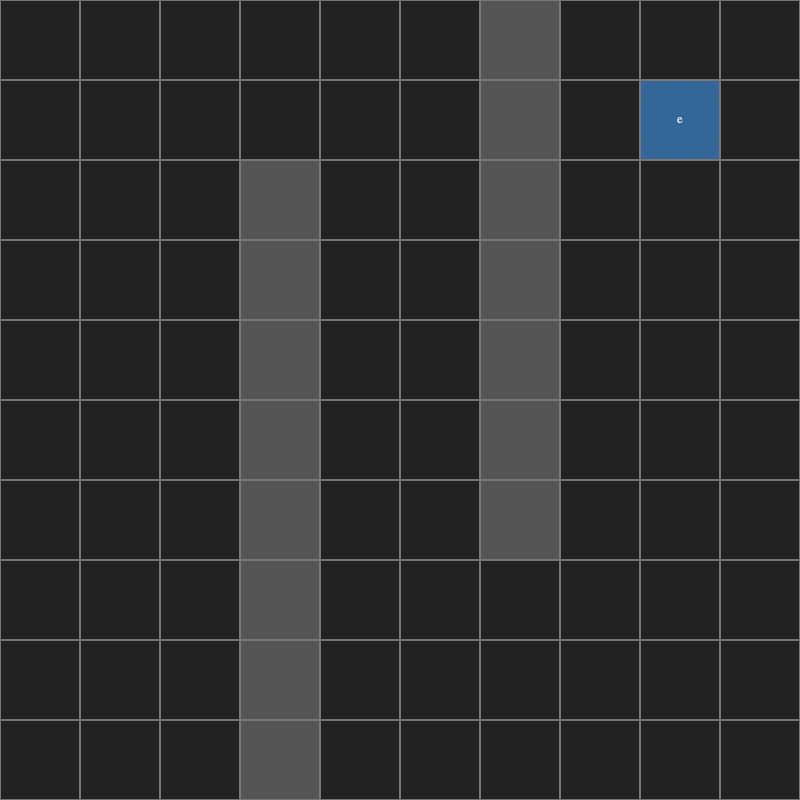
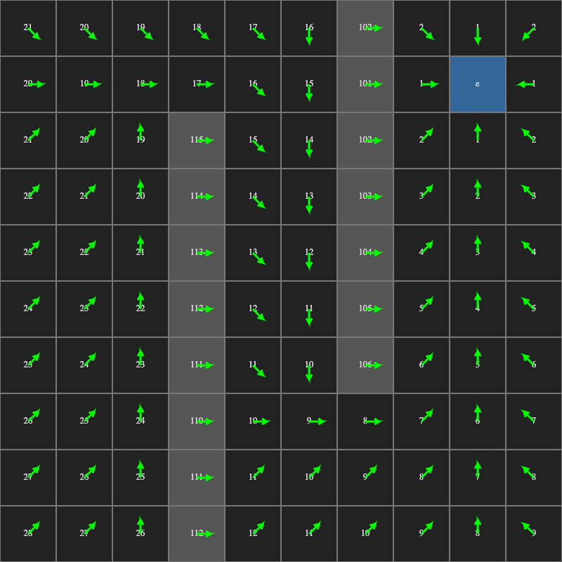

A hundred little agents, a map full of walls, and somewhere a target. We want them all to get there, around the walls, without piling on top of each other, and we want it all on the GPU.

<figure>
  <video src="/media/webgl2-wavefront-boids/flock-fish.mp4" poster="/media/webgl2-wavefront-boids/flock-fish.jpg" width="720" height="720" preload="none" muted loop playsinline></video>
  <figcaption>A hundred fish swimming around the rocks. Each click moves the target and the whole school turns. The fish are from Kenney's CC0 <a href="https://kenney.nl/assets/fish-pack">Fish Pack</a>.</figcaption>
</figure>

It took a few months and a lot of test versions to get here. This post walks through the idea in the order we built it: a map, a wavefront, a flow field, boids, and finally a character that walks along the field.

## A map to walk on

Everything starts with a grid. Each cell is either free or an obstacle, and one cell is the target. To make maps without typing coordinates, we built a small editor in January 2026. You click cells to make walls, click once more to place the target, and export the whole thing as JSON for the demos to load.


*The grid editor. Two walls, and the target `e` in the top right corner.*

## The wavefront

The first question every agent has is "how far am I from the target?" We answer it for every cell at once with a wavefront. The target starts at distance 0 and every other cell starts at infinity. Then, over and over, each cell looks at its four neighbors and takes the smallest one plus one:

```glsl
float L = texture(uDataSlot0, uv + direction[0]/uGridSize).r;
float R = texture(uDataSlot0, uv + direction[1]/uGridSize).r;
float T = texture(uDataSlot0, uv + direction[2]/uGridSize).r;
float B = texture(uDataSlot0, uv + direction[3]/uGridSize).r;

float minNeighbor = min(min(L, R), min(T, B));

if(isObastacle==0.0) {
    currDist = min(currDist, minNeighbor + 1.0);
} else {
    currDist = min(currDist, minNeighbor + 50.0);
}
```

Each cell is a pixel and each step is one pass of a fragment shader, using the same ping-pong framebuffers as our [WebGL2 particles](/work/webgl2-framebuffer-particles/). So the wave grows one ring per frame.

<figure>
  <video src="/media/webgl2-wavefront-boids/grid-wavefront.mp4" poster="/media/webgl2-wavefront-boids/grid-wavefront.jpg" width="800" height="800" preload="none" muted loop playsinline></video>
  <figcaption>The wavefront spreading from the target, slowed down to about six steps a second so you can follow it.</figcaption>
</figure>

Notice that an obstacle is not a hard wall. It's just a very expensive cell, so the wave can still pass through it at a big cost. In the editor that cost is 100, which is why the walls show numbers like 101 and 115. While the wave is still moving, a cell behind a wall can briefly get a number through the wall. A few frames later the real path around the wall reaches it and the smaller number wins.


*The settled wavefront. The bottom left corner is 28 steps away, because the path has to go around both walls.*

## From distances to arrows

Distances alone don't tell an agent which way to go. So a second pass turns them into a flow field. Each cell looks at all eight neighbors and points at the one closest to the target:

```glsl
float neighborDist = surrDistance[i];

if (neighborDist < minDist) {
    minDist = neighborDist;
    bestDir = direction[i];
}
```

There is one small rule for diagonals. If either of the two straight neighbors next to a diagonal is an obstacle, we skip that diagonal, so agents never cut the corner of a wall.


*The flow field. Follow the arrows from any cell and you reach the target.*

## Boids follow the arrows

Now the agents. Each one is again a pixel, holding its position and velocity, and each frame it adds up a few forces. The classic boids three are alignment (steer like your neighbors), cohesion (stay close to them) and separation (don't stand on them). On top of those we add the flow field as one more force:

```glsl
acc += alignmentForce(vel, avgVel, uAligWeight);
acc += cohesionForce(pos, avgPos, uCoheWeight);
if(density > 4.0) {
    acc += separationForce(gridUV, pos, avgPos, uSepaWeight);
}

vec2 flowDir = texture(uGradientTexture, gridUV).xy;
acc += flowDir * uFlowWeight;
```

The tricky part of boids is finding your neighbors. We don't loop over every other agent here. Instead, before the boids pass, we draw every agent as a single point into a small texture the size of the grid, with additive blending. Afterwards each cell holds the sum of the positions in it, the sum of the velocities, and a count:

```glsl
fragData[0] = vec4(vPosition, 1.0, 1.0);   // x, y, and 1 for the count
fragData[1] = vec4(vVelocity, 0.0, 1.0);
```

Divide by the count and you have the average position and velocity of everyone in your cell. That's all the boids rules need, and it costs one cheap draw call no matter how many agents there are. Here is the demo with every agent drawn as a plain dot:

<figure>
  <video src="/media/webgl2-wavefront-boids/flock-dots.mp4" poster="/media/webgl2-wavefront-boids/flock-dots.jpg" width="720" height="720" preload="none" muted loop playsinline></video>
  <figcaption>The same hundred boids as dots. We click twice and they flow around the rocks to each new target.</figcaption>
</figure>

The fish at the top are the exact same simulation. We only swap the dot for a fish sprite and turn it to face its velocity. The sprites face left, so a fish swimming right gets mirrored instead of rotated, otherwise it would swim upside down.

## Walking to a click

Next we wanted to give orders. In this version, 36 agents wait until you click. The click becomes the new target, the wavefront and the flow field are rebuilt from there, and the agents wake up and walk over:

<figure>
  <video src="/media/webgl2-wavefront-boids/click-dots.mp4" poster="/media/webgl2-wavefront-boids/click-dots.jpg" width="720" height="720" preload="none" muted loop playsinline></video>
  <figcaption>The agents sit still until the first click, then gather at the target. A second click sends them across the map.</figcaption>
</figure>

With only 36 agents we kept it simple: for separation every agent just loops over all the other pixels. That's 36 × 36 checks, which the GPU doesn't even notice.

## One character on the field

The last step goes the other way. Instead of a crowd of dots, one character walks on an isometric grid, and the flow field is drawn as arrows on the tiles. The character uses the same steering, and its sprite picks a walking direction from its velocity:

```glsl
float getAniType(vec2 vel) {
    if (length(vel.x) >= length(vel.y)) {
        return (vel.x >= 0.0) ? 1.0 : 0.0;
    }
    return (vel.y > 0.0) ? 2.0 : 3.0;
}
```

<figure>
  <video src="/media/webgl2-wavefront-boids/velocity-field.mp4" poster="/media/webgl2-wavefront-boids/velocity-field.jpg" width="816" height="432" preload="none" muted loop playsinline></video>
  <figcaption>Click a tile and every arrow turns toward it, and the character walks along them.</figcaption>
</figure>

## What's still open

We also tried a version where the steering is real acceleration instead of nudging the velocity directly. It moves more smoothly, but right now the character overshoots the target and keeps swinging past it, so it needs some kind of arrival or braking force before it's done. And the cat on the isometric grid is still test art. The fish worked out so well that the next version will probably get a proper CC0 character sheet too.

## What we took away

* A wavefront is just "smallest neighbor plus one", repeated. On the GPU that's one tiny fragment shader and a ping-pong.
* Make obstacles expensive instead of impossible. The math stays simple and the wave still goes around them.
* Turn distances into arrows once, and every agent can read its direction with a single texture lookup.
* To find neighbors on the GPU, splat agents into a grid with additive blending and divide by the count.
